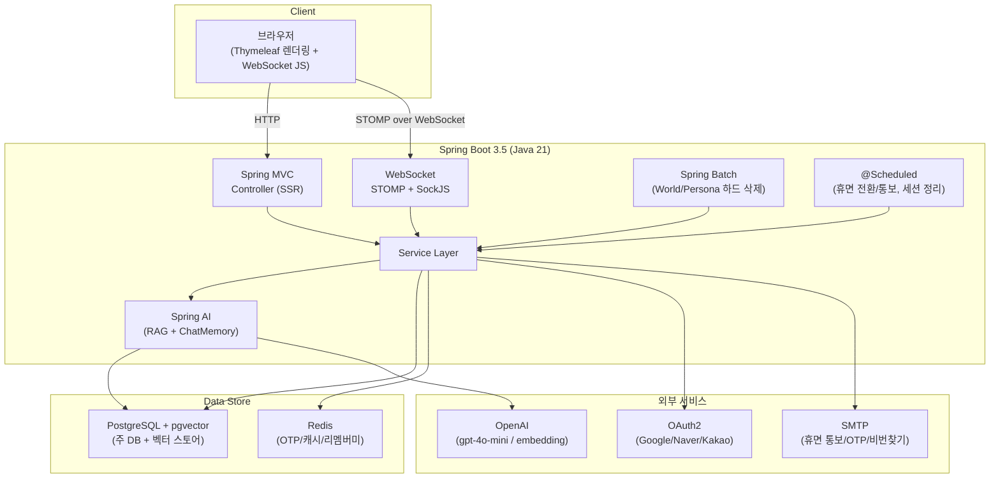
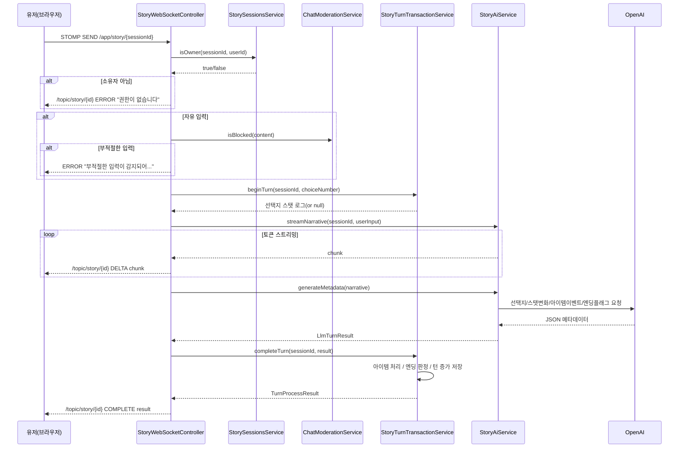
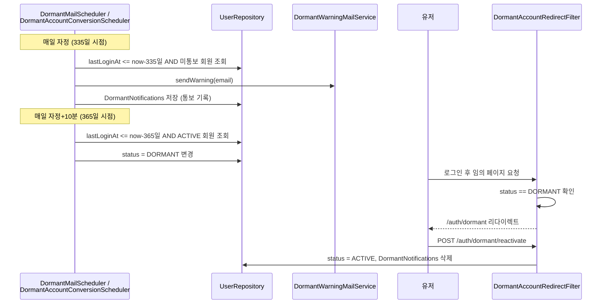

# world-tale-talk

> LLM 기반 인터랙티브 텍스트 스토리텔링(TRPG 스타일) 웹 애플리케이션


---

## 목차

- [팀원 소개](#팀원-소개)
- [프로젝트 소개](#프로젝트-소개)
- [빠른 시작 (Quick Start)](#빠른-시작-quick-start)
- [기술 의사결정](#기술-의사결정)
- [시스템 아키텍처](#시스템-아키텍처)
- [주요 기능](#주요-기능)
- [데이터베이스 설계](#데이터베이스-설계)
- [시퀀스 다이어그램](#시퀀스-다이어그램)
- [트러블슈팅](#트러블슈팅)
- [기술 스택](#기술-스택)
- [화면 라우팅 / API 명세서](#화면-라우팅--API-명세서)
- [환경 변수 설정](#환경-변수-설정)
- [프로젝트 구조](#프로젝트-구조)
- [팀 문서](#팀-문서)
- [라이선스](#라이선스)

---

## 팀원 소개

| 팀원 이름 | 담당                                                                                     |
|-----------|------------------------------------------------------------------------------------------|
| 김준용    | Spring Boot 백엔드 전체 설계/구현 (Security, JPA, WebSocket/STOMP, Spring AI RAG, Batch) |
| 강혜윰    | 프론트엔드 (Thymeleaf 템플릿) 전체 설계/구현                                             |


---

## 프로젝트 소개

### 프로젝트 개요

**world-tale-talk**은 유저가 세계관(World)과 페르소나(Persona)를 선택해 세션을 시작하고, LLM이 생성하는 서사를 매 턴 자유 입력 또는 선택지로 진행하는 인터랙티브 텍스트 스토리텔링 서비스입니다.

- 매 턴마다 LLM이 스토리 본문을 스트리밍 생성하고, 이어서 선택지/스탯 변화/아이템 이벤트/엔딩 트리거 등 메타데이터를 별도 호출로 생성
- 스탯(지혜/힘/민첩/카리스마/행운) 합산과 보유 아이템 보너스에 따라 GOOD/BAD/TRUE/SECRET/DARK 5종 엔딩 중 하나로 도달
- 세계관 설정 텍스트를 RAG(pgvector)로 임베딩해, 유저 입력과 유사도 높은 설정 조각만 골라 LLM 프롬프트에 주입
- 세션별 대화 이력은 커스텀 `ChatMemory` 구현체로 DB에 영속화해 LLM 컨텍스트로 재사용

### 만들게 된 이유

>최근 웹툰과 소설 시장을 보면 회귀/먼치킨 장르가 큰 인기를 끌고 있는데, 등장인물과 배경 설정만 조금씩 다를 뿐 전개 자체는 거의 동일하게 반복된다는 인상을 받았습니다.
>LLM을 활용하면 매번 다른 흐름의 이야기를 만들어낼 수 있겠다는 생각이 여기서 출발했습니다.
>
>관리자가 지정한 세계관/페르소나를 선택하고 선택지에 따라 스탯이 변화하거나 아이템을 획득하는 구조는 기존 LLM 기반 인터랙티브 스토리텔링 서비스들을 참고해 설계했습니다. 
>다만 선택지만으로 진행하는 방식은 "매번 다른 이야기, 반복되지 않는 전개"라는 지향점과 맞지 않다고 판단해, 자유 입력 프롬프트를 함께 지원하도록 했습니다. 자유도와 정황성(맥락 유지)을 이 프로젝트의 핵심 가치로 삼은 이유입니다.
> 
>이전에 이미지/스킬/몬스터 시스템까지 포함된 팀 프로젝트를 진행했던 적이 있는데, 리소스 제작에 적지 않은 시간이 들어간다는 걸 체감했습니다. 
>이번에는 그 시간을 아껴 백엔드 로직과 LLM 연동 자체에 더 깊게 투자하고 싶었고, 그래서 텍스트 콘텐츠에 집중하는 대신 세션 인증, WebSocket, Spring AI RAG, Spring Batch 등 새로운 기술 스택을 적극적으로 시도할 수 있었습니다.

- 개발 기간: 2026.05.30 ~ 2026.07
- 팀 구성: 2인
---

## 빠른 시작 (Quick Start)

### 사전 요구사항

| 항목       | 버전                        | 비고                              |
|------------|-----------------------------|-----------------------------------|
| JDK        | 21                          | [다운로드](https://adoptium.net/) |
| PostgreSQL | pgvector 익스텐션 설치 필요 | RAG 벡터 스토어                   |
| Redis      | -                           | OTP/캐시/세션/리멤버미 토큰 저장  |

### API 키 발급 (필수)

| 서비스            | 발급 링크                                                            | 용도                                                         |
|-------------------|----------------------------------------------------------------------|--------------------------------------------------------------|
| OpenAI            | [platform.openai.com/api-keys](https://platform.openai.com/api-keys) | 스토리 생성(`gpt-4o-mini`), 임베딩(`text-embedding-3-small`) |
| Google OAuth2     | [console.cloud.google.com](https://console.cloud.google.com/)        | 소셜 로그인                                                  |
| Naver 개발자센터  | [developers.naver.com](https://developers.naver.com/)                | 소셜 로그인                                                  |
| Kakao 개발자센터  | [developers.kakao.com](https://developers.kakao.com/)                | 소셜 로그인                                                  |
| 네이버 메일(SMTP) | 개인 계정                                                            | OTP/아이디/비번 찾기/휴면 통보 메일 발송                     |

### 실행 순서

**1. 저장소 클론**
```bash
git clone https://github.com/TODO/world-tale-talk.git
cd world-tale-talk
```

**2. PostgreSQL 준비 (pgvector)**
```postgresql
CREATE EXTENSION IF NOT EXISTS vector;
```
기동 시 Flyway가 `db/migration`의 마이그레이션(V1~V12)을 자동 적용합니다.

**3. Redis 실행**
```
localhost:6379 (기본값, application.yaml에서 변경 가능)
```

**4. 환경 변수 설정**

`.env` 파일 작성 방법은 [환경 변수 설정](#환경-변수-설정) 섹션 참고.

**5. 백엔드 실행**
```bash
./gradlew bootRun
```

---

## 기술 의사결정

### Thymeleaf (SSR) vs React (SPA)

>프론트 기술 스택으로 Thymeleaf (SSR)와 React (SPA) 중 선택해야 하는 시점이 있었습니다.
>Spring AI 기반 LLM 스트리밍 응답과 실시간 상호작용이 핵심 기능이라, 반응성이나 UI 완성도 면에서는 사실 SPA + REST API 조합이 더 유리한 선택지였습니다.
>다만 이 프로젝트를 혼자 진행하던 시점이라, SPA까지 새로 익히며 프로젝트 전체를 끌고 가는 것은 리스크가 크다고 판단해, 익숙한 Spring MVC/Thymeleaf 구조로 백엔드에서 화면까지 직접 통제하며 확실하게 완성하는 쪽을 선택했습니다.

### Security (Session기반)

>SPA가 아닌 Thymeleaf SSR 구조라 토큰 기반 통신이 필요 없어 세션 인증(HttpSession + SecurityContextHolder)을 선택했습니다. 
>매 요청을 서버가 세션으로 들고 있는 편이 이 구조에 자연스럽고, SessionRegistry 기반 동시 세션 제어나 세션 강제 만료(정지 처리 시 즉시 반영) 같은 기능도 프레임워크 차원에서 바로 적용할 수 있어 세션 기반 인증(HttpSession + SecurityContextHolder)으로 결정했습니다.
>
>리멤버미(자동 로그인)는 series/token(series는 고정, token은 로그인마다 갱신) 구조를 직접 구현했습니다.
>토큰 탈취가 의심되는 경우 해당 계정의 모든 자동 로그인 세션을 즉시 무효화하도록 했습니다.

### WebSocket — STOMP + SockJS 채택

>스토리 진행 화면은 유저의 선택지/자유 입력 전송과 LLM 스트리밍 응답 수신이 동시에 필요한 양방향 통신입니다. 
>SSE로도 응답 스트리밍은 가능했지만 SSE는 서버 -> 클라이언트 단방향이라 입력 전송에는 별도 채널이 필요했을 것이고, 양방향 실시간 통신에는 WebSocket이 더 적합하다고 판단했습니다.
> 
>raw WebSocket은 메시지 타입 분기나 세션별 구독자 관리를 전부 직접 구현해야 하는데, 이 프로젝트는 세션마다 목적지가 여러 개 필요하고 인증된 사용자만 접근해야 하는 구조였습니다. 
>STOMP를 얹으면 destination 기반 라우팅(@MessageMapping)과 구독자 관리(SimpMessagingTemplate.convertAndSend)를 프레임워크가 대신 처리해주고, spring-security-messaging으로 Security 연동도 가능해서 이 구조에 더 적합하다고 판단했습니다. 
>실무에서도 WebSocket+STOMP 조합이 널리 쓰이는 데다 이번 기회에 직접 사용해보고 싶었던 것도 이유입니다.
> 
>(자세한 내용은 [트러블슈팅](#트러블슈팅) 참고).

### Migration (Flyway)

>기존에는 JPA ddl-auto(update)로 스키마를 관리했는데, 이 방식은 엔티티를 수정하면 기존 데이터가 유실될 위험이 있었습니다. 
>그래서 Flyway를 도입해 모든 스키마 변경 이력을 버전 관리되는 SQL 파일로 남기도록 했습니다. 
>팀 프로젝트나 협업 시에는 엔티티 수정 사항이 SQL 파일 형태로 그대로 공유돼 추적이 쉬워진다는 이점도 있습니다. 
>또한 ddl-auto는 validate로 고정해, 마이그레이션으로 반영된 실제 스키마와 엔티티 정의가 일치하는지 애플리케이션 구동 시점에 다시 한번 검증하도록 이중 안전장치를 뒀습니다.

### MapStruct

>Entity-DTO 매핑에 ModelMapper 대신 MapStruct를 채택했습니다. 
>ModelMapper는 리플렉션 기반으로 동작해서 필드명이 어긋나거나 매핑이 잘못돼도 컴파일 시점에는 드러나지 않고, 실행 중에야 값이 비어있거나 잘못 매핑된 걸 뒤늦게 발견하게 되는 문제가 있었습니다.
>MapStruct는 어노테이션 프로세서로 컴파일 시점에 실제 매핑 구현체를 생성하는 방식이라, 매핑 안 된 필드를 실행 전에 확인할 수 있습니다.
>
>매핑 누락을 경고로만 남기고 넘어가지 않도록, MapStructConfig를 만들어 전체 매퍼에 공통 적용했습니다.
>이렇게 하면 DTO 필드 중 매핑되지 않은 게 하나라도 있으면 빌드 자체가 실패해서, 매핑 누락을 사람이 로그를 눈여겨봐야 알아채는 게 아니라 빌드 단계에서 강제로 걸러지도록 했습니다.

### Spring AI — Custom ChatMemory + RAG

>유저가 세계관의 페르소나가 되어 스토리를 만들어가는 프로젝트 특성상, 동일하고 반복적인 전개를 피하고 자유도를 보장하는게 주 핵심이였기때문에 채택하게 되었습니다.
>이를 위해 Spring AI를 채택해, 세계관 설정 텍스트(settingText)를 PostgreSQL 기반 VectorStore(pgvector)에 임베딩해두고, 매 턴 유저 입력과 유사도가 가장 높은 상위 5개 설정 조각만 검색해 LLM 프롬프트에 주입하는 RAG 구조를 구성했습니다.
>이렇게 하면 매번 전체 설정을 다 넣는 대신, 그 시점 유저 입력과 맥락이 맞는 설정만 골라 반영할 수 있어 정황성과 자유도를 동시에 확보할 수 있었습니다.
>
>임베딩은 별도 배치가 아니라 세계관 생성/수정/삭제 시점에 바로 반영되도록 연동해, 관리자가 세계관 설정을 바꾸면 RAG 검색 결과도 항상 최신 상태를 유지하도록 했습니다.

### Spring Batch

>세계관/페르소나는 소프트 삭제(유예기간) 후 실제로 완전히 지우는 하드 삭제가 필요했는데, 이 배치에 Spring Batch를 채택했습니다. 
>단순 조회 후 삭제만 하면 되는 로직이라 청크 단위 처리는 필요 없다고 판단해 Tasklet 방식으로 구현했고, 삭제 건별로 REQUIRES_NEW 트랜잭션을 분리해 하나가 실패해도 나머지 삭제에 영향이 없도록 했습니다.

---

## 시스템 아키텍처



---

## 주요 기능

### 스토리 진행

- 세계관/페르소나 선택 후 세션 생성, WebSocket으로 실시간 서사 스트리밍
- 자유 입력 / 선택지 두 방식으로 턴 진행, 자유 입력은 모더레이션(OpenAI Moderation API) 체크
- 스탯 변화, 아이템 획득/소실 이벤트, 진행도(%) 실시간 반영
- GOOD/BAD/TRUE/SECRET/DARK 5종 엔딩, 엔딩 이후 에필로그 진행
- 세션 중도 포기, 삭제(숨김) 기능

### 회원

- 일반 회원가입/로그인 + 소셜 로그인(Google/Naver/Kakao), 계정 연동/해제
- 이메일 변경(OTP 인증), 비밀번호 찾기/재설정, 아이디 찾기
- 리멤버미(자동 로그인, Redis 기반 탈취 감지)
- 정지 계정 처리, 탈퇴(개인정보 익명화 처리)
- 휴면 계정 자동 전환(장기 미접속) + 전환 예고 메일 + 본인 재로그인을 통한 휴면 해제

### 커뮤니티/운영

- 세계관 별점/리뷰, 신고(리뷰/채팅 내역)
- 공지사항
- 관리자 대시보드(회원 수/세계관 수/진행 세션 수/신고 대기 수), 세계관별 통계

### 관리자

- 회원/세션/세계관/페르소나 CRUD 및 상태 관리
- 아이템 등급별 스탯 보정 설정, 진행도 구간별 아이템 등급 확률 조정
- 신고 처리, 별점 관리, 공지 관리

### 배치/스케줄러

- 휴면 전환 예고 메일 -> 휴면 전환 -> 중도이탈 세션 정리 -> World/Persona 하드 삭제 (자정부터 10분 간격 분산 실행)

---

## 데이터베이스 설계


### PostgreSQL 테이블 (Flyway V1~V12 기준)

```
users                       - 회원 (loginId/email/password, role, status, lastLoginAt)
social_accounts             - 소셜 로그인 연동 (provider, providerId)
user_suspensions            - 정지 이력 (reason, suspendedAt, liftedAt)
dormant_notifications       - 휴면 전환 예고 메일 발송 여부 기록 (user 1:1)

worlds                      - 세계관 (genre, settingText, targetTurn, ratingAvg, playCount)
deleted_worlds              - 하드 삭제된 세계관 통계 스냅샷
personas                    - 페르소나 (world FK, background)
persona_base_stats          - 페르소나 기본 스탯 (지혜/힘/민첩/카리스마/행운)

story_sessions              - 스토리 세션 (status, currentTurn, endingType)
chat_messages                - 대화 이력 (ChatMemory 백엔드, turn/role/epilogue 구분)
session_items                - 세션별 보유 아이템 (등급, 스탯 보너스, 획득/버림 턴)
session_stat_logs            - 턴별 스탯 변화 로그
session_stat_snapshots        - 엔딩 시점 스탯 스냅샷 + 메인 스토리 요약

item_grade_configs            - 아이템 등급별 보정치 설정 (관리자 조정)
item_grade_probabilities      - 진행도 구간(EARLY/MID/LATE)별 등급 확률

world_ratings                 - 세계관 별점/리뷰
reports                       - 신고 (리뷰/채팅 내역 대상)
notices                       - 공지사항

+ Spring Batch 메타데이터 테이블(V10)
+ vector_store (pgvector, Spring AI RAG 청크/임베딩)
```

---

## 시퀀스 다이어그램

### 메인 스토리 턴 처리 (WebSocket)



LLM 호출 도중 예외 발생 시 `StoryTurnTransactionService.compensateTurn()`이 턴 증가/스탯 로그를 원상 복구하는 보상 트랜잭션으로 동작합니다.

### 휴면 계정 전환 + 재활성화



---

## 트러블슈팅

### - 백엔드
### 1. STOMP 메시지 핸들러에서 로그인 회원 정보가 null로 조회되는 문제
- **증상**: WebSocket(STOMP)으로 들어온 메시지를 처리할 때 `@AuthenticationPrincipal`로 회원 정보를 받으려 하면 null이거나 `Cannot construct instance of AuthenticatedUser` 에러가 발생
- **원인**: STOMP 메시징 파이프라인은 Spring MVC와 달리 `AuthenticationPrincipalArgumentResolver`가 자동 등록되지 않고, `simpUser` 헤더의 인증 정보를 스레드의 `SecurityContextHolder`로 옮겨주는 `SecurityContextChannelInterceptor`도 별도 필요
- **해결**: `WebSocketConfig`에 `addArgumentResolvers()`, `configureClientInboundChannel()` 오버라이드 추가, `spring-security-messaging` 의존성 추가

### 2. 배치 스케줄러 4개가 전부 자정에 몰려서 순차 대기
- **원인**: `@Scheduled` 기본 스레드풀 크기가 1이라, 동일하게 `cron = "0 0 0 * * *"`로 걸린 4개 스케줄러(휴면 통보/휴면 전환/중도이탈 세션 정리/World-Persona 하드 삭제)가 자정마다 순차 대기하며 지연
- **해결**: 가벼운 작업을 앞, 무거운 배치를 뒤로 10분 간격 분산 (`0 0 0`, `0 10 0`, `0 20 0`, `0 30 0`)

### 3. 휴면 전환 예고 메일이 재로그인 후 다시는 발송되지 않음
- **원인**: 통보 기록(`DormantNotificationsEntity`)이 재로그인(휴면 해제) 시점에 삭제되지 않아, 이후 다시 장기 미접속 상태가 돼도 "이미 통보함"으로 남아 영구히 재발송되지 않음
- **해결**: `UserService.reactivateUser()`에서 상태 변경과 함께 통보 기록 삭제

### 4. 일반 로그인/소셜 로그인의 인증 정보 타입 불일치
- **증상**: `@AuthenticationPrincipal`로 인증 정보를 꺼낼 때 일반 로그인은 `UserDetails` 구현체, 소셜 로그인은 `OAuth2User` 구현체로 타입이 달라, 컨트롤러마다 로그인 방식별 분기가 필요했습니다.
- **해결**: `AuthenticatedUser` 공통 인터페이스를 만들어 `CustomUserDetails`, `CustomOAuth2User`가 함께 구현하도록 했습니다. 컨트롤러는 로그인 방식과 무관하게 `@AuthenticationPrincipal AuthenticatedUser`로 통일해서 받을 수 있습니다.

### 5. 세계관/페르소나 하드 삭제 시 통계까지 함께 사라지는 문제
- **문제**: 통계를 실시간 계산 방식으로 내다 보니, 배치로 세계관을 하드 삭제하면 집계 대상 자체가 사라져 그동안의 통계 기록도 함께 사라지는 문제가 있었습니다.
- **해결**: 하드 삭제 직전에 `deleted_worlds` 테이블에 세계관 이름/장르/설명/설정 텍스트/목표 턴수/평균 별점/플레이 수와, 완료/중도포기 세션 수를 스냅샷으로 저장해, 삭제 이후에도 통계 로그가 남도록 했습니다.

### 6. `@WebMvcTest`에서 `@EnableJpaAuditing`이 안 먹는 문제
- **상황**: RestController가 아닌 일반 컨트롤러 + 프론트/백엔드 분리 작업 구조라, 컨트롤러 작업을 끝내도 프론트가 없어 직접 테스트할 방법이 없었습니다. 그래서 Mockito(`@WebMvcTest`)를 처음 사용하게 됐습니다.
- **문제**: `@WebMvcTest`는 웹 계층만 로드하고 JPA 관련 설정은 올리지 않는데, `@EnableJpaAuditing`이 메인 애플리케이션 클래스에 선언돼 있으면 `@WebMvcTest`가 이 클래스를 설정 소스로 가져가면서 auditing에 필요한 빈(`EntityManagerFactory` 등)을 찾지 못해 컨텍스트 로딩이 실패했습니다.
- **해결**: `@EnableJpaAuditing`을 메인 클래스에서 떼어내 별도의 `JpaAuditingConfig` 설정 클래스로 분리했습니다. `@WebMvcTest`가 메인 클래스만 설정 소스로 가져가도 이 어노테이션이 딸려오지 않아 문제없이 슬라이스 테스트가 가능해졌습니다.

### - 프론트엔드

### 1. Thymeleaf에서 session을 이용한 변수명을 사용했을 때 화면 로딩이 불가능한 문제

- **문제**: 변수명을 session으로 지정하여 페이지를 작성하였는데 해당 페이지를 열 수 없는 현상이 생겼습니다.
- **해결**: 변수명을 '[페이지명]session'으로 변경하여 예약어와 변수명 충돌을 해결하였습니다.

### 2. Thymeleaf inline script 데이터를 외부 JavaScript에서 읽지 못한 문제

- **증상**: 관리자 통계 페이지에서 Chart.js를 적용했을 때 첫 번째 그래프는 보이지만, 세계관/페르소나 이용 비율 그래프가 빈 화면으로 표시됐습니다.
- **원인**: 템플릿 내부에서 `const worldLabels = ...` 형태로 선언한 값을 별도 `.js` 파일에서 읽으려 했는데, 전역 객체(`window`)에 등록되지 않아 외부 스크립트에서 안정적으로 접근할 수 없었습니다.
- **해결**: Thymeleaf inline script에서 `window.adminStatsData` 객체로 차트 데이터를 명시적으로 주입하고, 외부 JavaScript는 해당 객체만 참조하도록 수정했습니다.

### 3. 답변 생성 중 중복 입력이 가능한 문제

- **증상**: AI 답변을 기다리는 동안 사용자가 다시 메시지를 입력하면 같은 턴에 여러 요청이 들어가거나, 추천 문구와 자유 입력 상태가 꼬이는 문제가 있었습니다.
- **원인**: WebSocket 응답 대기 상태와 입력창 활성화 상태가 분리되어 있지 않아, 서버 응답이 완료되기 전에도 전송 버튼과 엔터 입력이 계속 동작했습니다.
- **해결**: 메시지 전송 직후 입력창과 전송 버튼을 비활성화하고, AI 응답과 추천 문구 3개가 모두 렌더링된 뒤 다시 활성화했습니다. 이를 통해 한 턴당 하나의 사용자 입력만 처리되도록 UX 흐름을 고정했습니다.

### 4. 반응형 화면에서 스탯/버튼 UI가 흔들리는 문제

- **증상**: 채팅방 우측 스탯 영역과 관리자 표 버튼 영역이 화면 폭에 따라 줄바꿈되거나 버튼 길이가 달라져, 정보 비교와 조작이 불편했습니다.
- **원인**: 버튼과 그래프형 스탯 요소에 고정된 최소 폭과 정렬 기준이 부족했고, 긴 텍스트와 액션 버튼이 같은 표 셀 안에서 서로 다른 크기로 렌더링됐습니다.
- **해결**: 스탯은 10칸 막대그래프 형태로 통일하고, 버튼 영역은 동일한 최소 너비와 간격을 갖도록 CSS를 정리했습니다. 표 헤더는 가운데 정렬, 긴 리뷰/설명 텍스트는 왼쪽 정렬로 분리해 가독성을 개선했습니다.

---

## 기술 스택

| 분류      | 기술                                                            |
|-----------|-----------------------------------------------------------------|
| Language  | Java 21                                                         |
| Framework | Spring Boot 3.5.14                                              |
| RDB       | PostgreSQL 17.9-3                                               |
| View      | Thymeleaf (SSR)                                                 |
| ORM       | Spring Data JPA                                                 |
| Migration | Flyway                                                          |
| Security  | Spring Security (세션 기반), OAuth2 Client (Google/Naver/Kakao) |
| Real-time | Spring WebSocket (STOMP + SockJS)                               |
| Batch     | Spring Batch                                                    |
| AI        | Spring AI 1.1.6 (OpenAI, pgvector, RAG)                         |
| Mapping   | MapStruct 1.5.5                                                 |
| Mail      | JavaMailSender (SMTP)                                           |
| Build     | Gradle                                                          |

### Database

| 분류  | 기술                                                   |
|-------|--------------------------------------------------------|
| 주 DB | PostgreSQL (+ pgvector 익스텐션, RAG 벡터 스토어 겸용) |
| Cache | Redis (OTP/플레이 상태/리멤버미 토큰)                  |

### 외부 API

| 서비스                        | 용도                                                                                         |
|-------------------------------|----------------------------------------------------------------------------------------------|
| OpenAI                        | `gpt-4o-mini`(스토리 생성), `text-embedding-3-small`(임베딩), Moderation API(자유 입력 검열) |
| Google / Naver / Kakao OAuth2 | 소셜 로그인                                                                                  |


---

## 화면 라우팅 / API 명세서

### 화면 라우팅 (GET 뷰 렌더링 / POST 폼 처리)

#### 인증 (`/auth`)

| Method    | URL                        | 설명                                                |
|-----------|----------------------------|-----------------------------------------------------|
| GET       | `/auth/login`              | 로그인 화면                                         |
| GET, POST | `/auth/nickname`           | 닉네임 입력 화면 / 저장 (소셜 신규가입 강제 플로우) |
| GET       | `/auth/suspended`          | 정지 안내 화면                                      |
| GET       | `/auth/dormant`            | 휴면 안내 화면                                      |
| POST      | `/auth/dormant/reactivate` | 휴면 계정 해제 (본인 재로그인)                      |
| GET, POST | `/auth/signup`             | 회원가입 화면 / 처리                                |
| GET, POST | `/auth/find-password`      | 비밀번호 찾기 화면 / 메일 발송                      |
| GET, POST | `/auth/reset-password`     | 비밀번호 재설정 화면 / 처리                         |
| GET, POST | `/auth/find-id`            | 아이디 찾기 화면 / 메일 발송                        |

#### 마이페이지 (`/mypage`)

| Method    | URL                                | 설명                      |
|-----------|------------------------------------|---------------------------|
| GET       | `/mypage`                          | 마이페이지 메인           |
| GET, POST | `/mypage/profile`                  | 프로필 조회 / 닉네임 변경 |
| POST      | `/mypage/password`                 | 비밀번호 변경             |
| POST      | `/mypage/withdraw`                 | 회원 탈퇴                 |
| GET       | `/mypage/sessions`                 | 내 세션 목록              |
| GET       | `/mypage/ratings`                  | 내 별점 목록              |
| POST      | `/mypage/social/{socialAccountId}` | 소셜 계정 연동 해제       |

#### 세계관 / 페르소나

| Method | URL                                               | 설명                                       |
|--------|---------------------------------------------------|--------------------------------------------|
| GET    | `/`                                               | 메인 화면 (활성 세계관, 인기 세계관, 공지) |
| GET    | `/worlds`                                         | 세계관 목록                                |
| GET    | `/worlds/{id}`                                    | 세계관 상세                                |
| GET    | `/worlds/{id}/personas`                           | 세계관별 페르소나 목록                     |
| POST   | `/worlds/{worldId}/personas/{personaId}/sessions` | 세션 생성(새 게임 시작)                    |

#### 스토리 세션 (`/sessions`)

| Method    | URL                                         | 설명                      |
|-----------|---------------------------------------------|---------------------------|
| GET       | `/sessions/{id}/play`                       | 플레이 화면               |
| POST      | `/sessions/{id}/abandon`                    | 세션 포기                 |
| POST      | `/sessions/{id}/hide`                       | 세션 삭제(숨김)           |
| GET       | `/sessions/{id}/ending`                     | 엔딩 화면                 |
| POST, GET | `/sessions/{id}/epilogue`                   | 에필로그 시작 / 화면 조회 |
| POST      | `/sessions/{id}/complete`                   | 세션 완료                 |
| POST      | `/sessions/{sessionId}/items/{itemId}/drop` | 아이템 버리기             |

#### 별점 / 신고 / 공지

| Method    | URL                              | 설명                     |
|-----------|----------------------------------|--------------------------|
| GET, POST | `/worlds/{worldId}/ratings`      | 별점 등록 폼 / 등록/수정 |
| GET       | `/worlds/{worldId}/ratings/edit` | 별점 수정 폼             |
| GET, POST | `/reports/new`, `/reports`       | 신고 폼 / 등록           |
| GET       | `/notices`, `/notices/{id}`      | 공지 목록 / 상세         |

#### 관리자 (`/admin/**`) — `ROLE_ADMIN` 필요

| Method    | URL                                             | 설명                                     |
|-----------|-------------------------------------------------|------------------------------------------|
| GET       | `/admin`, `/admin/stats`                        | 대시보드 요약 통계 / 세계관별 통계       |
| GET, POST | `/admin/users`, `/admin/users/del`              | 회원 목록(활성/탈퇴)                     |
| GET       | `/admin/users/{id}`                             | 회원 상세                                |
| POST      | `/admin/users/{id}/suspend`, `/lift`, `/delete` | 정지 / 정지 해제 / 강제 탈퇴             |
| GET, POST | `/admin/worlds/**`                              | 세계관 CRUD, 활성화 토글, 삭제 대기/취소 |
| GET, POST | `/admin/personas/**`                            | 페르소나 CRUD, 삭제 대기/취소            |
| GET, POST | `/admin/notices/**`                             | 공지 CRUD                                |
| GET, POST | `/admin/ratings`                                | 별점 목록/삭제                           |
| GET, POST | `/admin/items/grades/**`                        | 아이템 등급 보정치 설정                  |
| GET, POST | `/admin/items/probabilities/**`                 | 아이템 등급 확률 설정                    |
| GET, POST | `/admin/sessions/**`                            | 세션 목록, 강제 포기, 숨김/복구          |
| GET, POST | `/admin/report`                                 | 신고 목록 조회(상태 필터) / 처리         |

### AJAX / WebSocket 엔드포인트 (실제 JSON 계약이 존재하는 부분)

#### AJAX (JSON request/response)

| Method | URL                        | 설명                   |
|--------|----------------------------|------------------------|
| GET    | `/auth/nickname/check`     | 닉네임 중복 검사       |
| GET    | `/auth/signup/check-id`    | 아이디 중복 검사       |
| GET    | `/auth/signup/check-email` | 이메일 중복 검사       |
| POST   | `/mypage/email/send-code`  | 이메일 변경 OTP 발송   |
| POST   | `/mypage/email/verify`     | OTP 검증 + 이메일 변경 |

#### WebSocket (STOMP)

| Destination                                               | 설명                                                   |
|-----------------------------------------------------------|--------------------------------------------------------|
| `/app/story/{sessionId}/start`                            | 스토리 시작 (첫 서사 생성)                             |
| `/app/story/{sessionId}`                                  | 메인 스토리 턴 처리                                    |
| `/app/epilogue/{sessionId}`                               | 에필로그 턴 처리                                       |
| `/topic/story/{sessionId}`, `/topic/epilogue/{sessionId}` | 서버 -> 클라이언트 브로드캐스팅 (DELTA/COMPLETE/ERROR) |

---

## 환경 변수 설정

`application.yaml`이 참조하는 값 기준입니다.

```env (env.exmaple 참고)
DB_HOST=
DB_PORT=
DB_NAME=
DB_USERNAME=
DB_PASSWORD=

REDIS_HOST=
REDIS_PORT=

OPENAI_API_KEY=
GOOGLE_CLIENT_ID=
GOOGLE_CLIENT_SECRET=
NAVER_CLIENT_ID=
NAVER_CLIENT_SECRET=
KAKAO_CLIENT_ID=
KAKAO_CLIENT_SECRET=

#네이버 smtp 설정
MAIL_USERNAME=
MAIL_PASSWORD=

# 비밀번호 재설정 링크 등에 사용, 미설정 시 http://localhost:8080 사용
APP_BASE_URL=
```

로컬 개발 시 예시 값:
```env
DB_HOST=localhost
DB_PORT=5432
DB_NAME=world_tale_talk
REDIS_HOST=localhost
REDIS_PORT=6379
APP_BASE_URL=http://localhost:8080
```

`application.yaml` 주요 설정 (실제로는 위 `.env` 값을 `${...}`로 참조하도록 externalize 되어 있음):

```yaml
datasource:
  url: jdbc:postgresql://${DB_HOST}:${DB_PORT:5432}/${DB_NAME}?currentSchema=public

data:
  redis:
    host: ${REDIS_HOST}
    port: ${REDIS_PORT:6379}

app:
  base-url: ${APP_BASE_URL:http://localhost:8080}

ai:
  openai:
    embedding:
      options:
        model: text-embedding-3-small
    chat:
      options:
        model: gpt-4o-mini

app:
  dormant:
    inactivity-days: 365
    warning-before-days: 30
```

---

## 프로젝트 구조

```
com.worldtaletalk
├── batch/                 # World/Persona 하드 삭제 배치 (Spring Batch)
│   ├── job/
│   └── service/
├── chat/                  # 채팅(대화) 메시지 (ChatMemory 저장소 역할)
├── config/                # Security, WebSocket, JPA Auditing, QueryDSL, Redis, Scheduling 설정
├── global/
│   ├── basetime/          # BaseTimeEntity (createdAt/updatedAt)
│   ├── handler/           # GlobalExceptionHandler
│   ├── mail/              # SMTP 발신 서비스 (OTP, 아이디/비번 찾기, 휴면 통보)
│   ├── security/          # CustomUserDetails, 필터, OAuth2
│   └── util/
├── inventory/             # 세션별 아이템 보유 현황
├── item/                  # 아이템 등급/확률 설정
├── moderation/            # 자유 입력 텍스트 모더레이션 (OpenAI Moderation API)
├── notice/                # 공지사항
├── persona/               # 페르소나 + 기본 스탯
├── rating/                # 세계관 별점/리뷰
├── report/                # 신고
├── session/               # 스토리 세션 (진행 상태, 턴수, 엔딩)
│   ├── controller/        # StoryViewController, StoryWebSocketController(STOMP)
│   └── scheduler/         # 중도이탈 세션 자동 정리
├── stat/                  # 세션별 스탯 변화 로그 / 엔딩 스냅샷
├── statistics/            # 관리자 대시보드 통계
├── story/                 # LLM 연동 핵심 로직
│   ├── cache/              # Redis 기반 플레이 상태 캐시
│   ├── memory/              # CustomChatMemory (Spring AI ChatMemory 구현체)
│   └── service/              # StoryAiService(LLM 호출), StoryTurnTransactionService(트랜잭션 분리)
├── user/                   # 회원, 소셜 계정, 정지, 휴면 계정
│   └── scheduler/           # 휴면 전환/통보 메일 배치
└── world/                   # 세계관 (설정 텍스트가 RAG 임베딩 대상)
```

---

## 팀 문서

| 문서           | 링크                                                                                                              |
|----------------|-------------------------------------------------------------------------------------------------------------------|
| 기획/설계 문서 | [링크](https://docs.google.com/spreadsheets/d/1G_nXWRewH5Utb7UlUwSQaGAKFmiC5GSwaM3PoUCJEHc/edit?usp=sharing)      |
| 팀원별 소감    | 김준용 : [링크](https://docs.google.com/document/d/1tCKMNSHSzw_FwGeCAH7Vco8m-6PpcoEJXYo0E4zRRl8/edit?usp=sharing) |
|                | 강혜윰 : [링크](https://docs.google.com/document/d/1g-ZsqJNWIoNqfiMIS4AuXvsL02XBE5mbXJCeQTNcAd8/edit?usp=sharing) |

---

## 라이선스

MIT License

---

<p align="center">world-tale-talk — Built with Spring Boot & Thymeleaf</p>
